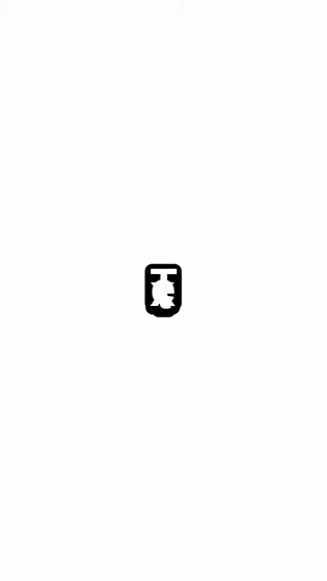

# Text Morph

Turn any text into a slimy, gooey kinetic-typography animation and export it as a video.

Each word is split into small letter chunks on rounded blobs, linked by stretchy strands.
The chain wobbles, stretches into a zigzag, and then **fuses** back into a readable word,
with the blobs melting together like slime. Built for vertical (9:16) social video.

<p align="center"></p>

**Live demo:** https://modelsals482-ops.github.io/text_morph/

## Features

- Type one word or phrase per line; the animation cycles through them
- **Fuse / Split** button, plus auto-fuse at the end of every word so viewers can read it
- 13 built-in fonts (Helvetica, Plus Jakarta Sans, Inter, Poppins, Montserrat, Space Grotesk, Rubik, Bebas Neue,
  Archivo Black, Playfair Display, Permanent Marker, Pacifico, JetBrains Mono)
- Upload your own font (`.ttf`, `.otf`, `.woff`, `.woff2`); it never leaves your browser
- **Venom strands:** letters close together share thick webbing, stretched ones thin out
  toward the middle (never hair thin). The **Venom** slider scales the mass (0 = plain thin lines)
- Sliders for speed, font size, slime (goo) strength and wobble
- Colour pickers for background, blobs and letters
- **Transparent background** for overlaying in your video editor
- Export to **MP4** (H.264) or **WebM** (VP9), 720 x 1280, 30 fps

## Usage

It is one HTML file with no build step and no dependencies.

1. Open `index.html` in Chrome or Edge (or use the live demo link).
2. Type your words, pick a font and colours, tweak the sliders.
3. Click **Export video**. It records one full loop of all your words in real time
   (4 words x 3 s = 12 s) and downloads the file.

Keep the tab visible while exporting: browsers pause animations in background tabs.

To run it from a local server instead of opening the file:

```bash
python -m http.server 8000
```

then open http://localhost:8000.

## Transparent video

MP4 / H.264 cannot store transparency, so with **Transparent background** on, the export
is always WebM (VP9 with alpha). Chrome, OBS, DaVinci Resolve and After Effects (with a
WebM plugin) read it directly. If your editor needs ProRes 4444 instead, convert it with
[ffmpeg](https://ffmpeg.org/):

```bash
ffmpeg -c:v libvpx-vp9 -i text-morph.webm -c:v prores_ks -profile:v 4444 -pix_fmt yuva444p10le text-morph.mov
```

The `-c:v libvpx-vp9` before `-i` matters: ffmpeg's default VP9 decoder drops the alpha channel.

## How it works

- Every chunk is a node pulled toward a target point by a damped spring, so it overshoots
  and lags behind its neighbours, which is what makes the motion feel elastic.
- Targets blend between a "split" pose (a wiggly column or a stretched zigzag) and the
  "fused" pose (the word laid out on one line, wrapped at spaces if it is too wide).
- Each strand is a tapered tube shaped between the edges of the two letter boxes: it flares
  out where it meets a letter (like a goo fillet) and pinches to a thin neck in the middle.
  Its thickness falls off with the distance between the letters, down to a fixed minimum,
  and its base never gets wider than the letter box it attaches to. Strands are built from
  overlapping discs, so the outline has no corners.
- Where two strands leave the same letter, a curved web fills the V between them, so the
  notch becomes a rounded goo fillet.
- The blobs and strands are drawn on an off-screen canvas, then composited through an SVG
  "goo" filter (Gaussian blur plus an alpha threshold), which merges shapes that touch.
- The letters are drawn on top without the filter so they stay crisp.
- Export uses `canvas.captureStream()` + `MediaRecorder`.

## Browser support

Best in **Chrome** and **Edge** (MP4 and WebM export, transparency). Firefox runs the
animation and exports WebM. Safari support for the canvas goo filter is limited.

## Host your own copy (GitHub Pages)

Fork the repo, then **Settings > Pages > Build and deployment > Source: Deploy from a branch**,
branch `main`, folder `/ (root)`. Your copy appears at
`https://<your-username>.github.io/text_morph/` within a minute or two.

## License

[MIT](LICENSE)
